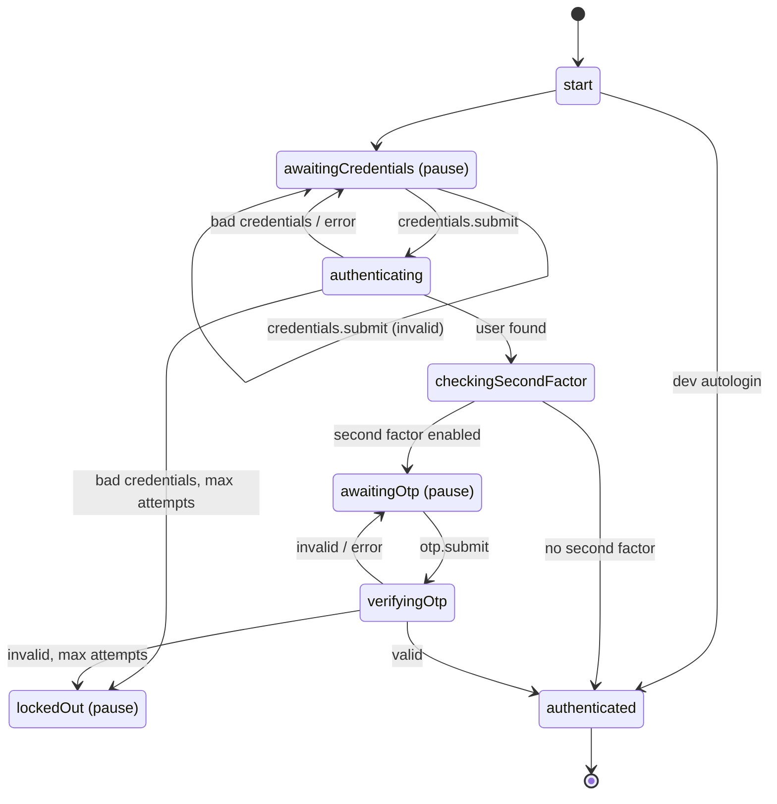
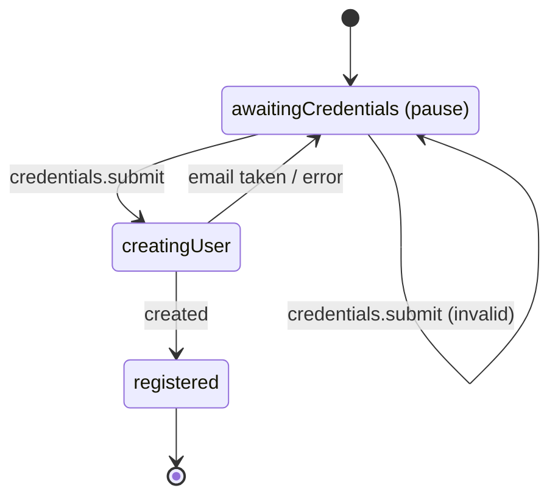
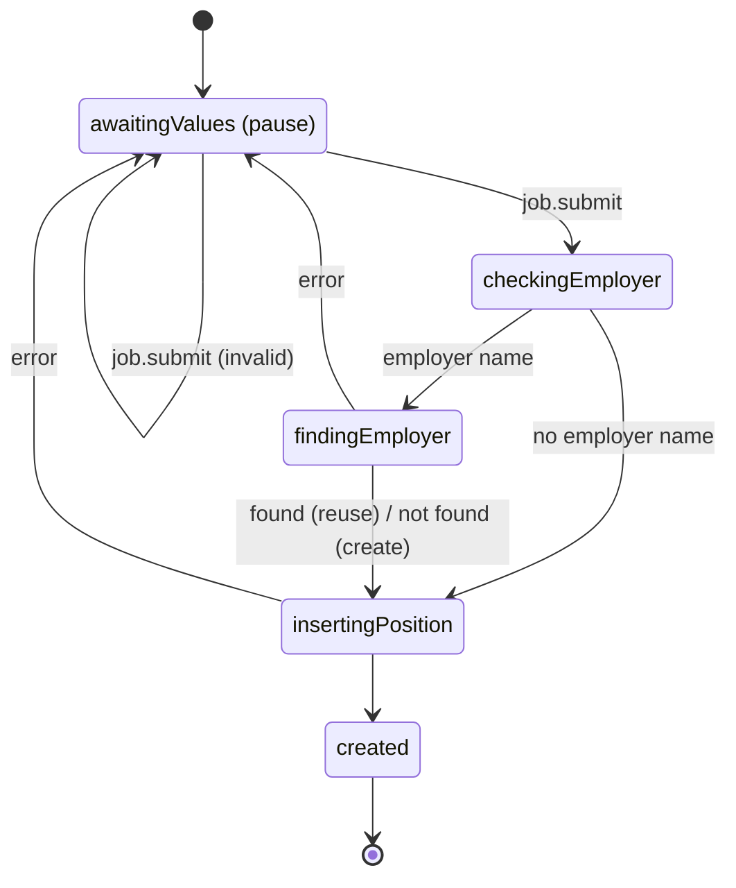
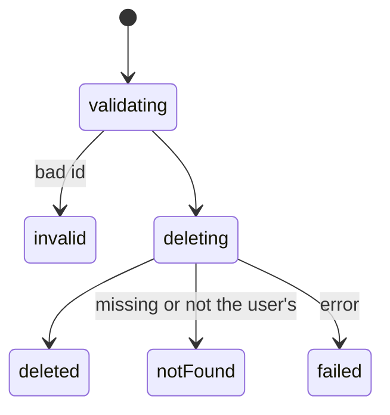

# State

The main use cases in the React Router prototype are modeled as explicit
[XState](https://stately.ai/docs/xstate) machines. Route actions turn each
form submission into a machine event, run the machine until it pauses for
input or finishes, and map the resulting state to an HTTP response.

## Conventions

- **Pure machine, server provider.** `xMachine.ts` holds the logic; its side
  effects are named actors whose defaults throw. `xMachine.server.ts` provides
  the real implementations. Tests provide stubs with `machine.provide()`.
- **Domain state names**, never URLs. The route decides where to redirect.
- **`pause` tag** marks states waiting for user input. Multi-request flows
  (log-in) persist the paused snapshot in a signed cookie and resume it on the
  next request.
- **Serializable, secret-free context.** Passwords and codes travel only in
  events and actor input, never in context (which may end up in a cookie).
- **Outcomes are states.** Actor failures become states or context
  (`problem`), not thrown errors; server providers log them.
- **Events from forms** use a `type` field (whitelisted per route) plus string
  fields.

## Log-in machine

`src/features/auth/loginMachine.ts`. Spans several requests: the snapshot is
kept in the `_login` cookie (10 minute lifetime) while the machine is paused.

Notes:

- The second factor is not implemented yet: `secondFactorEnabled` defaults to
  false and there is no code form. Tests exercise the OTP path with stubs.
- `lockedOut` is not final, so it stays in the cookie until the cookie
  expires. This is a soft limit (clearing cookies resets it); real protection
  needs a server-side attempt counter.

## Sign-up machine

`src/features/auth/signupMachine.ts`. Finishes within one request.

## Job machines

`src/features/jobs/createJobMachine.ts` and `deleteJobMachine.ts`. Both finish
within one request; their actors are bound to the user's Hasura token per
request.

## Testing without a browser

- **Machine unit tests** (`*Machine.test.ts`): stub actors, run with
  `asyncInterpret` / `runToPause`, resume from persisted snapshots.
- **Route tests** (`src/app/routes/*.test.ts`): call loaders and actions with
  plain `Request` objects; `~/api.server` is replaced by an in-memory fake
  Hasura (`src/test/fakeSdk.ts`).
- **Smoke script** (`npm run smoke`): raw HTTP against a running app with
  `DEV_AUTOLOGIN=false`.
