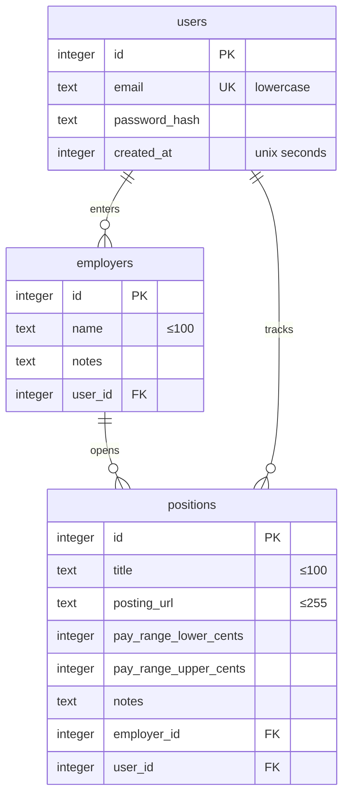

# Entity Relationships

The app stores its data in SQLite (`app/src/db/schema.ts`, migrations in
`app/drizzle/`). The Hasura/Postgres schema in `prototypes/` is kept for
reference only.

- Every query for employers and positions is scoped to the signed-in user's
  id in `app/src/db/repository.server.ts`. This replaces Hasura's row
  permissions. A position can only point at an employer owned by the same
  user.
- An employer can only be deleted once it has no positions. The foreign key
  is `ON DELETE RESTRICT`, and the app checks first.
- Pay is stored as whole cents. The repository converts it to and from
  currency units.
- Migrations must be **expand/contract**. During a blue/green deploy or a
  rollback, the previous app version runs against the new schema. See
  [Deployment](../operations/deployment.md#migrations).
