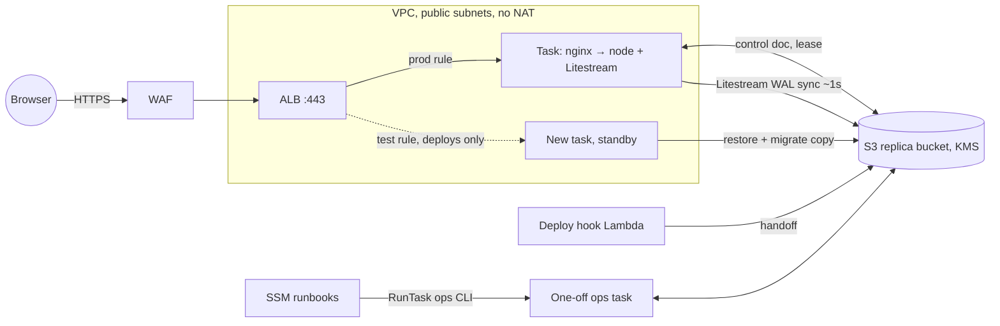

# Architecture

The app runs as one container on AWS Fargate. The container holds nginx, the
React Router server and Litestream, which replicates SQLite to S3. Everything
is defined with CDK in `infra/`.

## Stacks

| Stack | What | Notes |
|---|---|---|
| `JobsappCi` | ECR repo, GitHub OIDC roles | Deployed once by an admin. Deploys are trusted only from the `production` environment. |
| `JobsappData` | KMS key, replica bucket | Retained, has termination protection, and is versioned. Old versions are kept 30 days. |
| `JobsappApp` | VPC, ALB, cert, DNS, WAF, ECS service, deploy hook, alarms | ECS built-in blue/green with a 10-minute bake. |
| `JobsappOps` | SSM runbooks, daily restore test, budget, operator role | See [Runbooks](./runbooks.md). |

## One writer at a time

SQLite allows one writer. While a deploy is in progress, two tasks run. So the
tasks agree through a **control document** in S3
(`control/writer.json`), which is only changed with S3 conditional writes.

- The **writer** holds a 45 s lease and renews it every 10 s. It replicates
  with Litestream to its own *generation* (`db/gen-000042/`) and accepts
  writes.
- A **standby** restores the latest generation and runs migrations on that
  copy. That also proves the new migrations work on real data. It then serves
  the copy read-only. Writes get `503` with `Retry-After`, and the SQLite
  connection itself is opened read-only.
- **Claiming** has two phases:
  1. Mark the document `claiming`.
  2. Restore generation *g*.
  3. Run an integrity check and migrations.
  4. Snapshot the result to *g+1*.
  5. Mark the document `active` with generation *g+1*.

  A crash at any point leaves generation *g* as the latest complete copy.
- A writer that can't renew its lease makes itself read-only before the lease
  could expire. Every change of writer starts a new generation, so a stale
  writer can never corrupt the active replica.
- On SIGTERM the writer freezes, finishes its Litestream sync and releases the
  document.

The code is in `app/src/ops/control.ts` (the protocol) and
`app/src/ops/writer.server.ts` (the coordinator).

**Recovery point:** about 1 s (Litestream's sync interval). **Recovery time
after a crash:** about 1 minute, made up of lease expiry plus a restore.

## Security

- TLS ends at the ALB, using the AWS recommended TLS policy. HTTP redirects to
  HTTPS. nginx adds HSTS, CSP, `nosniff`, a referrer policy and
  `frame-ancestors 'none'`.
- WAF applies the AWS common and known-bad-inputs rules, a rate limit on
  `/login` (20 requests per 5 min per IP) and a global rate limit.
- Tasks accept traffic only from the ALB's security group. They run as a
  non-root user on a read-only root filesystem, with only `/data` and `/tmp`
  writable.
- The bucket is KMS-encrypted (CMK with rotation), requires TLS, blocks public
  access and is versioned. Only the account root may delete object versions.
- Cookie secrets live in Secrets Manager and support rotation without signing
  users out.
- CI has no long-lived keys (GitHub OIDC). Pull requests get only the
  read-only CDK lookup role.
- Operators use the `jobsapp-operator` role, which requires MFA. They run
  runbooks, and every execution is recorded in CloudTrail.
- cdk-nag (AwsSolutions) runs on every synth. Each exception is reviewed in
  `infra/lib/nag.ts`.

## Deliberate cost trade-offs

These depart from the Well-Architected guidance, at roughly $35–45/month in
total:

| Choice | Saves | Instead |
|---|---|---|
| Public subnets with public IPs, no NAT gateway | ~$32/mo | Security group admits only the ALB; S3 traffic goes through a free gateway endpoint |
| One task, SQLite | RDS/Aurora ~$15–50+/mo | Litestream about 1 s recovery point; brief write pause during deploys |
| No ALB or S3 access logs, no Container Insights | a few $/mo | App/nginx JSON logs, WAF metrics, EMF metrics |
| Prod only, one account | a second environment | The green task plus the test listener checks every deploy before production |

Rough monthly cost:

| Item | Cost |
|---|---|
| ALB | ~$18 |
| Fargate (0.25 vCPU / 1 GB, ARM) | ~$9 |
| Public IPv4 addresses | ~$11 |
| WAF | ~$8 |
| KMS, Route 53, Secrets Manager, S3, logs | a few dollars |

An AWS Budget alerts at 80% of `monthlyBudgetUsd`.
