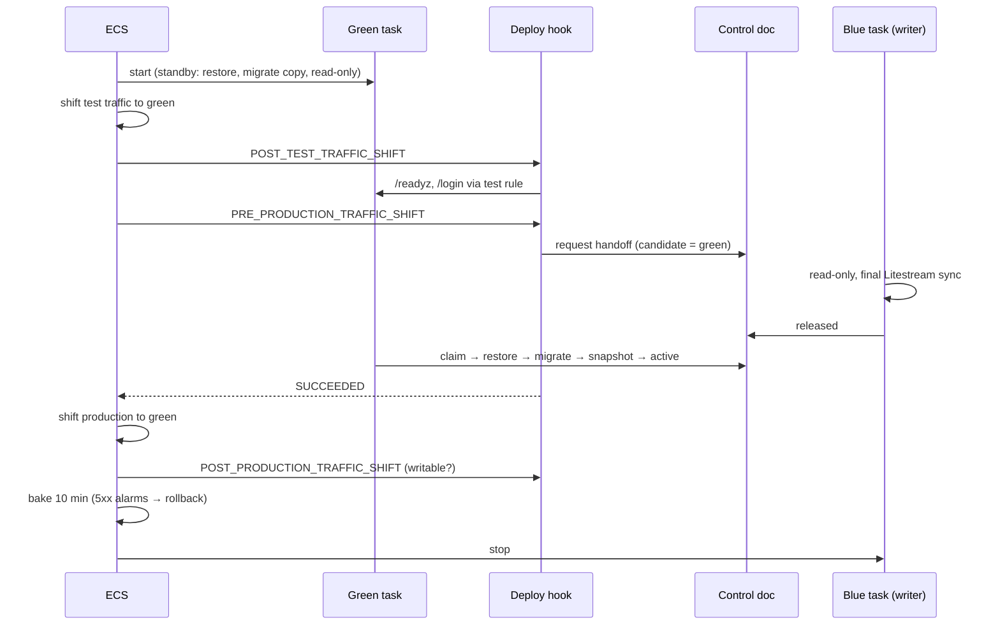

# Deployment

## First-time setup

Do this once, as an AWS admin, in the target account and region.

1. Bootstrap CDK:

   ```sh
   cd infra && npm ci && (cd ../app && npm ci)
   npx cdk bootstrap aws://<account>/<region>
   ```

2. Create `infra/cdk.context.json` with your settings. These identify you, so
   they're not in `cdk.json`:

   ```json
   {
     "jobsapp:domainName": "jobs.example.com",
     "jobsapp:hostedZoneId": "Z0123456789ABC",
     "jobsapp:hostedZoneName": "example.com",
     "jobsapp:alarmEmail": "you@example.com"
   }
   ```

   Commit the file after the first synth with credentials, because CDK caches
   the availability-zone lookup there.

3. Deploy the CI stack. It creates the ECR repo and the GitHub OIDC roles:

   ```sh
   npx cdk deploy JobsappCi
   ```

4. In GitHub, go to **Settings → Environments → `production`**:
   - Add **required reviewers** (approve each deploy).
   - Set the variables `AWS_ACCOUNT_ID`, `AWS_REGION`, `DOMAIN_NAME`,
     `HOSTED_ZONE_ID`, `HOSTED_ZONE_NAME` and `ALARM_EMAIL`.

5. Run the **Deploy** workflow, either from the Actions tab or by pushing to
   `main`. The first run creates the data, app and ops stacks. The first task
   finds an empty bucket and becomes the writer of generation 1.

6. Confirm the SNS email subscription for alarms. Then run the
   `jobsapp-VerifyBackup` runbook once (see [Runbooks](./runbooks.md)).

## Each deploy

`.github/workflows/deploy.yml` builds the arm64 image, pushes it as
`jobsapp:<git sha>` (ECR tags are immutable) and runs
`cdk deploy --exclusively JobsappData JobsappApp JobsappOps`. ECS then runs
the blue/green deployment:



From the blue task freezing until production traffic moves to green, writes
get `503` with `Retry-After: 5`. Reads keep working. This pause usually takes
a few seconds and grows with the size of the database restore.

### Rollback

ECS rolls back automatically when:

- a hook fails, for example because the handoff didn't finish within 4 minutes
  or a smoke check failed;
- a deployment alarm fires during the bake (target or ALB 5xx).

On rollback, ECS calls the `PRODUCTION_TRAFFIC_SHIFT` hook again with traffic
going back to blue. The hook hands the writer role back to blue's revision.
Blue restores the latest generation, so **writes made on green are kept**.
CloudFormation then marks the stack update as failed and rolls back the task
definition.

For a manual rollback, revert the commit and let the deploy run. In an
emergency, use the `jobsapp-RollbackDeployment` runbook.

## Migrations

Migrations run when a task becomes the writer, and on every standby's copy as
a dry run. During a deploy or rollback, the **previous** version of the app
may run against the **new** schema. So every migration must be
backward-compatible ("expand/contract"):

- ✅ Add a table, a nullable column, a column with a default, or an index.
- ❌ Rename or drop a column or table, or tighten a constraint, in the same
  release that stops using it.
- To remove something, do it in two releases:
  1. Ship code that no longer uses it.
  2. Ship the migration that drops it.

Generate migrations with `npm run db:generate` in `app/` and review the SQL.

## Local production-like testing

```sh
docker compose up --build -d     # app-a + LocalStack S3
./app/tools/handoff-test.sh      # handoff, crash takeover, point-in-time restore
docker compose down -v
```
